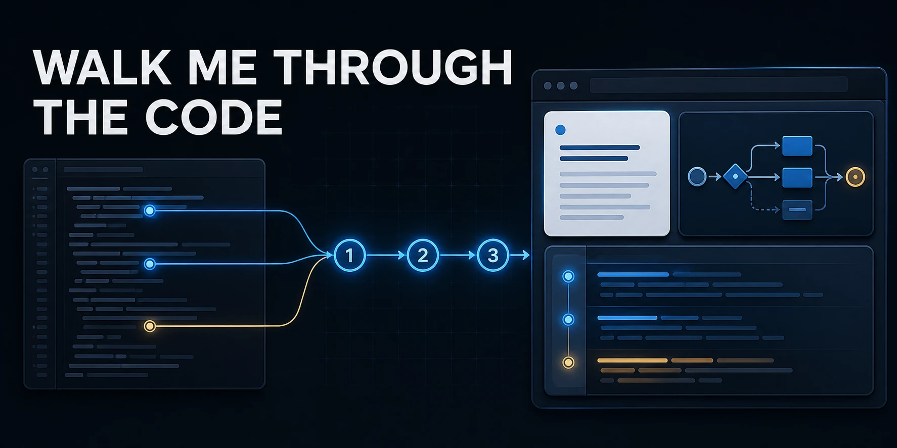

# Walk Me Through the Code



Walk Me Through the Code helps you understand unfamiliar code without turning
the explanation into a wall of text or static documentation.

Invoke the installed skill by name with a focused request such as "Use Walk Me
Through the Code to explain how login works." Your coding agent investigates
the current working files, builds a source-backed walkthrough, and opens it in
a local browser Viewer. You can move through the behavior step by step, inspect
the exact source behind each claim, and keep asking questions from inside the
walkthrough.

It is useful when you are:

- joining an unfamiliar codebase
- reviewing a change before editing or approving it
- tracing a behavior across several files
- trying to understand a function, module, request flow, or value transformation
- learning how the code works while keeping the explanation tied to current source

## From a question to an interactive walkthrough

1. Invoke Walk Me Through the Code by name and ask your agent to explain one
   coherent behavior, file, function, data flow, or current change.
2. The agent traces the relevant path through the current working files and
   supporting evidence.
3. Walk Me Through the Code opens a structured walkthrough in your browser,
   beginning with the purpose and overall flow before moving into technical
   detail.
4. Navigate between explanation steps and exact source excerpts.
5. Select a section, a passage, or specific source lines and ask a follow-up
   about that context. Use **Analyze** for direct source-backed answers or
   **Learn** for guided explanations and optional understanding checks.

The walkthrough adapts to the behavior being explained. It can combine a
plain-language story, system flow, request sequence, responsibilities, value or
execution traces, exact source excerpts, and focused callouts without forcing
every explanation into the same template.

## What you can do in the Viewer

- Follow a structured explanation while keeping your place in the overall flow.
- Inspect repository-relative paths, symbols, line ranges, and saved source excerpts.
- Select explanation passages, whole sections, or individual source lines as
  context for a follow-up question.
- Ask for a simpler explanation, a deeper technical treatment, or a focused,
  unscored understanding check.
- See when saved source evidence has changed, moved, or disappeared from the
  current working files.
- Keep walkthroughs, private question drafts, answers, and session history in
  local product storage.

The Viewer runs locally and serves its own bundled interface. Your coding agent
remains responsible for investigating the project and answering follow-up
questions.

## What it is not

Walk Me Through the Code is not a hosted documentation service, public sharing
platform, code editor, or replacement for your coding agent. It does not try to
document an entire repository at once. It is designed for one coherent question
at a time, grounded in the working files you actually have.

It also does not silently change the project while explaining it. The installed
skill keeps walkthrough artifacts and session state outside the explained
repository and leaves explanation mode before separately requested
implementation work begins.

The npm package is a command-line tool with a bundled agent skill. It does not
expose a supported JavaScript library API.

## Invoke the skill by name

Explicit invocation is the default, so ordinary code questions do not
unexpectedly open the interactive Viewer. Use the invocation supported by your
agent host:

```text
Codex:       $walk-me-through-code Walk me through how login works.
Claude Code: /walk-me-through-code Explain the current changes.
OpenCode:    Use the walk-me-through-code skill to trace the import flow.
```

Codex users who prefer automatic implicit invocation can edit
`~/.agents/skills/walk-me-through-code/agents/openai.yaml` and set:

```yaml
policy:
  allow_implicit_invocation: true
```

Restart Codex after changing the policy. This customizes the managed skill, so
`wmtc skill verify --host codex` will report that its contents differ from the
packaged version. Preserve or replace that customization deliberately when
upgrading.

For a Walkthrough Artifact you already have, open it directly with:

```sh
wmtc open path/to/walkthrough.json --skill-version 0.1.2
```

## Installation

### Ask your agent

> Install Walk Me Through the Code from
> https://github.com/hypertectonic/walk-me-through-the-code and verify it for
> my Codex, Claude Code, or OpenCode host. Follow the repository's `AGENTS.md`
> and do not overwrite an existing skill installation.

### Install from GitHub before the registry release

Use a source checkout and install the tarball produced by `npm pack`. Direct
`npm install` from the Git URL is not a supported installation path.

```sh
git clone https://github.com/hypertectonic/walk-me-through-the-code.git
cd walk-me-through-the-code
git checkout main
node -e "const [major, minor] = process.versions.node.split('.').map(Number); if (major !== 24 || minor < 15) throw new Error('Node >=24.15.0 <25 is required')"
corepack npm --version
corepack npm ci
corepack npm pack
corepack npm install --global ./hypertectonic-walk-me-through-the-code-0.1.2.tgz
wmtc --version
wmtc compatibility
wmtc skill install --host codex
wmtc skill verify --host codex
```

Replace `codex` in the last two commands with `claude-code` or `opencode` for
that host. Do not use `sudo`. If the global npm prefix is not writable, stop
and configure a user-writable npm global prefix before retrying.

### Install from npm

The later registry route is shorter:

```sh
corepack npm install --global @hypertectonic/walk-me-through-the-code@0.1.2
wmtc --version
wmtc compatibility
wmtc skill install --host codex
wmtc skill verify --host codex
```

Again, choose exactly one supported host value: `codex`, `claude-code`, or
`opencode`.

### Supported agent hosts

`wmtc skill install` creates a managed user-level skill installation:

- Codex: `~/.agents/skills/walk-me-through-code`
- Claude Code: `~/.claude/skills/walk-me-through-code`
- OpenCode: `~/.config/opencode/skills/walk-me-through-code`

If the destination already contains an unmanaged, modified, or incompatible
installation, the command fails without replacing it. Preserve the reported
directory and resolve the conflict deliberately before retrying.

Restart or reload the agent host if it was already running when the skill was
installed.

## Local data and privacy boundary

The Viewer binds to `127.0.0.1` by default, serves bundled assets, and protects
the browser session with an unguessable cookie. Walkthroughs, questions,
responses, and saved sessions use one local product state root:
`WMTC_STATE_DIRECTORY` when set, otherwise `~/.wmtc/`. Keep that state root
outside the repository you are explaining.

`wmtc` does not provide a hosted service or public sharing. The optional
`--share private` mode is only for a trusted LAN or Tailnet. Your agent host is
a separate trust boundary and may have its own data handling policy, so review
that policy before sharing sensitive source.

## Requirements

- Node.js `>=24.15.0 <25`
- npm `12.0.2` and Git for the source-checkout installation route
- Codex, Claude Code, or OpenCode
- A local browser for the Viewer

Runtime `0.1.2` supports skill version `0.1.2` only. Keep the runtime and skill
versions paired.

## Updating and troubleshooting

For a newer source release, check out that release and repeat `corepack npm ci`,
`corepack npm pack`, and the exact tarball installation. Then run `wmtc compatibility`
and repeat the concrete install and verify commands for your host. Version
0.1.2 deliberately does not overwrite an existing skill, including an older
managed installation. If it reports `SKILL_OUTDATED`, preserve the destination
and follow the newer release's migration instructions.

If `wmtc` is not found, confirm that npm's global binary directory is on
`PATH`, then restart the shell. If the skill verifies but is not visible,
restart or reload the host. If `wmtc open` cannot launch a browser, open the
printed local `origin` URL manually.

Walk Me Through the Code is available under the [MIT License](LICENSE).
